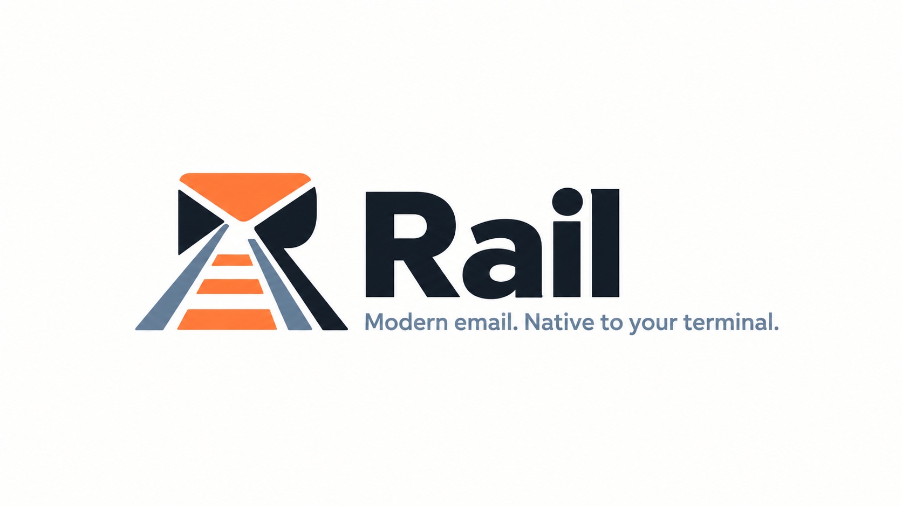

<h1 align="center">
  <picture>
    <source media="(prefers-color-scheme: dark)" srcset="assets/brand/rail-dark.png">
    <source media="(prefers-color-scheme: light)" srcset="assets/brand/rail-light.png">
    
  </picture>
</h1>

[](https://github.com/vitosans/rail/actions/workflows/ci.yml)
[](#license)


Rail is a terminal mail client for Gmail and Microsoft 365, written in Rust. It keeps a local copy
of your mail in SQLite, synced by a small background daemon, so every list, search and open is a
local query and the interface never waits on the network. It is built for people who live in a
terminal and want something in the spirit of mutt with threads, a unified inbox across accounts,
readable HTML and a command palette. It also speaks MCP, so an AI coding agent can help you set it
up without ever seeing your secrets.

> **Rail is pre-1.0 and you cannot read mail in it yet.** Account setup, background sync and
> search work today. The mail views (thread list, reader) are the next thing being built. Running
> `rail` with an account configured prints that the TUI is not built yet and exits with
> status 2.

## Contents

- [Status](#status)
- [Install](#install)
- [Quick start](#quick-start)
- [Reading mail](#reading-mail)
- [Account setup](#account-setup)
- [Using Rail from an AI agent (MCP)](#using-rail-from-an-ai-agent-mcp)
- [Security and privacy](#security-and-privacy)
- [Configuration](#configuration)
- [Commands](#commands)
- [Troubleshooting](#troubleshooting)
- [Contributing](#contributing)
- [License](#license)

## Status

**Works today**

- Setup wizard (`rail setup`) and a flag form for scripts (`rail account add`), including
  organisation presets and Microsoft admin consent.
- OAuth login for Gmail / Google Workspace and Microsoft 365; tokens kept in the OS keyring, a
  private file, or 1Password.
- Gmail sync into the local store: labels, message envelopes, and bodies of recent threads, kept
  current by a background daemon that can start at login (`rail daemon install`).
- `rail search` over the local store and, through Gmail's own search, the whole mailbox.
- `rail doctor`, a single health check for config, store, tokens, sync and the daemon.
- An MCP server (`rail mcp`) for setting up and inspecting Rail from an AI agent.

**Coming**

- Next: reading mail in the terminal (thread list, sidebar, reader, palette, display-quality HTML).
- Then: actions (archive, label, delete) and composing and sending, with agent sends governed by
  the per-account `ai_send` policy.
- Then: Microsoft 365 sync. Microsoft 365 accounts can be added and logged in today, but do not
  sync and are searched locally only.
- Later: search operators, layout and theme options, inline images.

**Pre-1.0 caveats.** Config keys, command output and the store's schema may change between
releases. The store migrates forward on its own; there is no downgrade path. Rail is tested on
Linux and macOS only.

## Install

Rail builds from source with Cargo. You need Rust 1.88 or newer and a C compiler (SQLite is
bundled and compiled in). Supported platforms are Linux and macOS.

```sh
git clone https://github.com/vitosans/rail
cd rail
cargo install --locked --path crates/rail
```

This puts `rail` in `~/.cargo/bin`. To upgrade, pull and run the same command; the first command
of the new version replaces any older daemon still running.

## Quick start

```sh
rail setup                 # add an account: guided steps, then a browser login
rail sync                  # fill the local store and watch progress
rail search invoice        # one line per matching thread
rail doctor                # check that everything is in order
rail daemon install        # keep syncing after you log out and back in
```

1. **`rail setup`** opens the setup wizard (running `rail` with no config does the same). Choose a
   preset your organisation gave you, or set up your own app: the wizard shows the portal steps
   from [Account setup](#account-setup), opens the portal with `o`, asks for the values it gave
   you, and logs you in through the browser. It needs an interactive terminal; in scripts use
   [`rail account add` with flags](#commands).
2. **`rail sync`** wakes the background sync and shows progress (counts only, never mail) until
   each account is caught up. Newest mail arrives first, so recent mail is searchable within
   seconds, but a first sync of a large mailbox takes hours (about 250 messages a minute, under
   Gmail's quota). Set [`history_days`](#sync-settings) to sync only recent mail. Ctrl-C stops
   watching, not the sync.
3. **`rail search <query>`** prints date, account, sender and subject for each matching thread,
   newest first. Gmail's search syntax works for the Gmail part.
4. **`rail doctor`** reports on the config, store, token backend, each account's tokens and sync,
   the daemon and the login unit.
5. **`rail daemon install`** writes a systemd user unit (Linux) or a launchd agent (macOS) so the
   daemon starts at login. Without it, the daemon starts on demand whenever a `rail` command needs
   it and keeps running while any account is configured.

### Keys

| Key | Action |
|---|---|
| `↑` / `↓` | Move within a list. |
| `Tab` / `Shift-Tab` | Change focus between fields. |
| `Enter` | Choose or continue. |
| `Space` | Tick or untick the checkbox. |
| `Esc` | Go back one step. |
| `F1` | Open the provider portal, or the preset's help link. |
| `o` | On the Instructions step, open the provider portal in your browser. |
| `r` | Retry when an error is shown. |
| `c` | Copy the admin-consent URL shown with an error, or the login URL on the Login step (OSC 52; some terminals ignore it, so select the URL on screen if nothing was copied). |
| `q` | Quit, except while typing in a text field. |
| `Ctrl-C` | Quit from anywhere. While an account is being saved, it waits for the save to finish. |

These are the wizard's default keys, the `wizard.*` actions in the table below; each can be changed.

The wizard exits 0 if at least one account was saved and 1 with `setup cancelled; nothing was
saved` otherwise. Quitting while the browser login is pending cancels that login. An account whose
save had already started is always finished, never left half-written; Rail then says so and exits
0. If you quit after an admin-consent error, Rail prints the admin-consent URL once the terminal is
back so you can forward it to an administrator. When stdout is not a terminal, every way of opening
the wizard prints a hint and exits 2.

Every key Rail reads is an *action* with an id and a default key. Change one in `config.toml`:

```toml
[keys]
"list.filter" = "/"
"reader.open_browser" = "O"
"global.palette" = ":"
```

A key name is a character (`a`, `O`, `/`), a named key (`enter`, `esc`, `tab`, `backtab`,
`space`, `up`, `down`, `left`, `right`, `pageup`, `pagedown`, `home`, `end`, `f1` to `f12`),
either with `ctrl-`, `alt-` or `shift-` in front (`ctrl-r`, `shift-tab`), or two keys with a
space between them for a sequence (`g x`). A key you set replaces that action's default keys.
`rail setup` refuses to start, naming the file and line, when `[keys]` names an action it does not know,
a key it cannot read, `Ctrl-C` (which always quits), or a key another action of the same view
already uses (a key that starts another action's sequence counts). A view's own key wins over a
global one: `q` closes the reader but quits from the list.

Today only the wizard reads `[keys]`, so the check runs when `rail setup` starts. The `global.*`,
`list.*`, `sidebar.*` and `reader.*` actions below take effect in the mail screen, which a later
task in this release adds; `?` will list the keys of the view you are in there, marking the ones
you changed.

| Action | Works in | Default keys | What it does |
|---|---|---|---|
| `global.quit` | global | `q` | Quit Rail. |
| `global.palette` | global | `:` | Open the command palette. |
| `global.help` | global | `?` | Show the keys for this view. |
| `list.open` | list | `enter` | Open the thread. |
| `list.filter` | list | `/` | Filter the list as you type. |
| `list.sidebar` | list, sidebar | `b` | Show or hide the sidebar. |
| `list.account_1` | list, sidebar | `1` | Go to account 1's inbox. |
| `list.account_2` | list, sidebar | `2` | Go to account 2's inbox. |
| `list.account_3` | list, sidebar | `3` | Go to account 3's inbox. |
| `list.account_4` | list, sidebar | `4` | Go to account 4's inbox. |
| `list.account_5` | list, sidebar | `5` | Go to account 5's inbox. |
| `list.account_6` | list, sidebar | `6` | Go to account 6's inbox. |
| `list.account_7` | list, sidebar | `7` | Go to account 7's inbox. |
| `list.account_8` | list, sidebar | `8` | Go to account 8's inbox. |
| `list.account_9` | list, sidebar | `9` | Go to account 9's inbox. |
| `list.unified` | list, sidebar | `0` | Go to the unified inbox. |
| `list.refresh` | list, sidebar, reader | `ctrl-r` | Sync now; reconnect to the daemon. |
| `list.down` | list | `j` `down` | Next thread. |
| `list.up` | list | `k` `up` | Previous thread. |
| `list.page_down` | list | `pagedown` `ctrl-d` | One page down. |
| `list.page_up` | list | `pageup` `ctrl-u` | One page up. |
| `list.top` | list | `home` `g g` | Newest thread. |
| `list.bottom` | list | `end` `G` | Oldest thread. |
| `sidebar.focus` | list, sidebar | `tab` | Move between the sidebar and the list. |
| `sidebar.down` | sidebar | `j` `down` | Next mailbox. |
| `sidebar.up` | sidebar | `k` `up` | Previous mailbox. |
| `sidebar.open` | sidebar | `enter` | Show this mailbox. |
| `reader.next` | reader | `n` | Next message. |
| `reader.prev` | reader | `p` | Previous message. |
| `reader.expand` | reader | `tab` | Expand or collapse the message. |
| `reader.unfold` | reader | `enter` | Show or hide the quoted lines. |
| `reader.open_browser` | reader | `o` | Open the message in the browser. |
| `reader.attachments` | reader | `a` | List the attachments. |
| `reader.follow_link` | reader | `g x` | Open a link. |
| `reader.back` | reader | `q` `esc` | Close the thread. |
| `reader.down` | reader | `j` `down` | Next line. |
| `reader.up` | reader | `k` `up` | Previous line. |
| `reader.page_down` | reader | `pagedown` `space` | One page down. |
| `reader.page_up` | reader | `pageup` | One page up. |
| `reader.top` | reader | `home` `g g` | First line. |
| `reader.bottom` | reader | `end` `G` | Last line. |
| `wizard.back` | wizard | `esc` | Go back one step. |
| `wizard.portal` | wizard | `f1` | Open the provider portal or the preset's help. |
| `wizard.next_field` | wizard | `tab` | Next field. |
| `wizard.prev_field` | wizard | `backtab` | Previous field. |
| `wizard.next` | wizard | `enter` | Choose or continue. |
| `wizard.up` | wizard | `up` `k` | Move up. |
| `wizard.down` | wizard | `down` `j` | Move down. |
| `wizard.page_up` | wizard | `pageup` | Scroll one page up. |
| `wizard.page_down` | wizard | `pagedown` | Scroll one page down. |
| `wizard.top` | wizard | `home` | Scroll to the top. |
| `wizard.bottom` | wizard | `end` | Scroll to the end. |
| `wizard.open_portal` | wizard | `o` | Open the portal from the instructions. |
| `wizard.toggle` | wizard | `space` | Tick or untick the checkbox. |
| `wizard.retry` | wizard | `r` | Retry after an error. |
| `wizard.copy_url` | wizard | `c` | Copy the URL shown. |

## Reading mail

This describes the mail screen as it will work when it ships. `rail` cannot open it yet (with an
account configured it still prints that the TUI is not built yet), so none of this is reachable
today.

The thread list shows the unified inbox: the account's colour dot, the date, the people, the
message count, `★` for starred and `📎` for attachments, and the subject; unread threads are bold.
`1` to `9` show one account's inbox, `0` the unified inbox again. The sidebar (shown at 100 columns
and wider; `b` toggles it, `Tab` moves into it) lists every account and label with its unread
count; `Enter` opens one.

`Enter` opens a thread. At `split_threshold` columns (140 by default) and wider the reader opens
beside the list; narrower, it covers the screen. `q` or `Esc` closes it. Messages are oldest
first; unread ones and the latest are expanded. `j`/`k` move the cursor, `n`/`p` jump between
messages, `Tab` expands or collapses one, and `Enter` on `[n quoted lines]` shows the quoted text.

HTML mail is shown as Rail's plain-text rendering, with each link as a numbered marker such as
`[1]`; in terminals that support hyperlinks (iTerm2, WezTerm, kitty, Ghostty, VS Code, Windows
Terminal, foot, Alacritty, GNOME Terminal and other VTE terminals; not inside tmux or screen) the
marker is clickable. `g x` opens a link: the marker on the cursor line, or the number you type when
the line has none or several. Rail shows the address first and opens only `http`, `https` and
`mailto` links. `a` lists the thread's attachments (name, type, size); opening and saving them
comes in a later version.

`o` opens the message's original HTML in your browser. Rail writes it to a private (0600) file
under its cache directory (`~/.cache/rail/open/`, or `$XDG_CACHE_HOME/rail/open/`) with scripts,
frames and connections blocked, and removes the file when you close the reader. The first time in a session Rail asks
first, because **remote images in the message load in the browser**, which can tell the sender
you opened it; Rail itself never loads them. A message whose body is not stored yet is fetched
first. A message with no HTML part says so: its text is all there is.

Bodies of recent mail (`body_cache_days`) are already in the store. An older message shows
**fetching…** while the daemon fetches its body from Gmail; the rest of the thread stays readable,
and the text appears when it lands. If the fetch fails the message says why.

`/` filters the list as you type: plain words search subjects, senders, recipients and stored
bodies; `from:`, `to:` (also Cc), `subject:`, `has:attachment`, `is:unread`, `is:starred`,
`before:YYYY-MM-DD`, `after:YYYY-MM-DD` (local dates, by when the mail arrived) and
`account:<name>` narrow it; quote values with spaces (`from:"Dana Reyes"`). A thread matches when
one of its messages matches all of them. Anything else is searched as words, and the status bar
shows how Rail read your filter, so a typo such as `form:dana` shows up as a word. `Enter` keeps
the filter; `Esc` clears it. The filter searches the local store only (`rail search` also asks
Gmail).

`:` opens the command palette: type a few letters of a key action for the current view, an account or a label
and press `Enter`; the key bound to each command is shown beside it. `:errors` lists the session's recent
errors. `?` shows the keys of the view you are in, marking the ones you changed in `[keys]`.

The status bar shows each account's sync state (`✓` caught up, `⟳` syncing with a count during
the first sync, `!` needs a login), whether the daemon can be reached, and notices. When the
daemon cannot be reached the list still reads from the store; `Ctrl-r` reconnects (and starts a
sync).

## Account setup

Rail ships no OAuth client of its own: you register one per provider once (or use a preset from
your organisation), then log in. The wizard walks you through the same steps shown here.

### Gmail / Google Workspace

1. In Google Cloud Console create a project and enable the **Gmail API**.
2. **OAuth consent screen**: External. **Publishing status must be "In production"**, even
   unverified. An app left in "Testing" has its refresh tokens expire after 7 days, and Rail will
   keep asking you to log in.
3. **Credentials**: create an **OAuth client ID** of type **Desktop app** and copy the client id
   and secret. A desktop-app secret is not actually secret; keeping it in `config.toml` is fine (or
   keep it in [1Password](#tokens-in-1password)).
4. Log in with `rail setup`, or:

   ```sh
   rail account add gmail --address you@example.com \
     --client-id XXXX.apps.googleusercontent.com --client-secret GOCSPX-...
   ```

   A browser opens for consent. Google warns that your own app is unverified; continue.

<!-- guide:google v1 -->
**The same steps with `gcloud`.** `gcloud` can create the project and enable the API, but it cannot
create a desktop OAuth client, so steps 2 and 3 stay in the browser. Pick a project id: 6 to 30
characters, lowercase letters, digits and hyphens, starting with a letter and not ending with a
hyphen:

```sh
gcloud auth login
gcloud projects create <project-id>
gcloud config set project <project-id>
gcloud services enable gmail.googleapis.com
```

Then, in the browser:

- the consent screen at `https://console.cloud.google.com/apis/credentials/consent?project=<project-id>`:
  External, then publish ("In production");
- the credentials page at `https://console.cloud.google.com/apis/credentials?project=<project-id>`:
  Create credentials, OAuth client ID, Desktop app, and download the JSON file.

An AI agent connected over MCP can walk you through exactly these steps (see
[Using Rail from an AI agent](#using-rail-from-an-ai-agent-mcp)).

### Microsoft 365 / Outlook

1. In Azure Portal, **App registrations** > New. Supported account types: pick what matches your
   mailbox (work/school, personal, or both). Redirect URI: platform **Mobile and desktop
   applications**, value `http://127.0.0.1`. Rail listens on `http://127.0.0.1:<random port>`, and
   Azure matches any port for a loopback redirect. If the portal refuses an `http://127.0.0.1` URI,
   add it by editing the app's **Manifest** (`replyUrlsWithType`) instead.
2. Under **Authentication**, set "Allow public client flows" to **Yes**. Rail is a desktop app and
   holds no client secret; without this Microsoft answers `AADSTS7000218`.
3. **API permissions**: Microsoft Graph delegated `Mail.ReadWrite`, `Mail.Send`, `User.Read`,
   `offline_access`.
4. Log in with `rail setup`, or:

   ```sh
   rail account add m365 --address you@example.com --client-id <application-id>
   ```

   The client ID is the **Application (client) ID** on the registration's **Overview** page, not
   the *Object ID*. For a single-tenant app ("Accounts in this organizational directory only") also
   pass `--tenant <tenant-id-or-domain>` (or fill in the wizard's *Tenant* field): Microsoft refuses
   the default `common` endpoint for single-tenant apps. Add `--tenant` too if your organisation
   restricts `common`.

<!-- guide:microsoft v1 -->
**The same steps with `az`.** The Azure CLI can do the whole registration of an app for work or
school accounts (single or multiple organisations); personal Microsoft accounts use the portal steps
above. Use the tenant id or a domain the tenant owns for `<tenant>`, and `AzureADMyOrg` (one
organisation) or `AzureADMultipleOrgs` for `<audience>`:

```sh
az version
az login --tenant <tenant>
az account show --query tenantId --output tsv
az ad app create --display-name Rail --sign-in-audience <audience> --public-client-redirect-uris http://127.0.0.1 --is-fallback-public-client true --query appId --output tsv
az ad sp show --id 00000003-0000-0000-c000-000000000000 --query "oauth2PermissionScopes[?value=='Mail.ReadWrite' || value=='Mail.Send' || value=='User.Read' || value=='offline_access'].{value:value, id:id}" --output table
az ad app permission add --id <app-id> --api 00000003-0000-0000-c000-000000000000 --api-permissions <mail-readwrite-id>=Scope <mail-send-id>=Scope <user-read-id>=Scope <offline-access-id>=Scope
```

`az ad app create` prints the Application (client) ID; use it as `<app-id>` and as `--client-id`.
`az ad sp show` lists the ids of the four Microsoft Graph permissions for `az ad app permission add`.
An administrator can then approve Rail for the whole organisation. Approval needs the app's identity
in the tenant (an "already exists" error from the first command means it is done); if the second
command reports that the permissions or the service principal are not found, wait a minute and run
it again, because directory changes take a moment to propagate:

```sh
az ad sp create --id <app-id>
az ad app permission admin-consent --id <app-id>
```

### Work or school accounts and admin consent

**Single or multi-tenant.** "Accounts in this organizational directory only" (single tenant) is
right for one organisation; log in through its tenant ID or domain. Choose "Accounts in any
organizational directory" only when several organisations share one registration; then `common`
works, but each organisation still has to consent.

**Finding the tenant ID.** In Azure Portal open **Microsoft Entra ID** > **Overview** and copy the
*Tenant ID*, or copy the *Directory (tenant) ID* from your app registration's **Overview**. A domain
the tenant owns (`contoso.onmicrosoft.com`, or a verified domain such as `contoso.com`) works in the
same places.

**Admin consent.** Many organisations stop users from approving apps themselves. An administrator
approves Rail once for everyone, in any of three ways:

- *From the wizard.* On the Details step tick **I am an administrator of this tenant**. Rail opens
  Microsoft's admin-consent page for your tenant, waits for the redirect to `http://127.0.0.1`, and
  confirms, then continues with your own login. The tenant must be a concrete tenant ID or domain,
  not `common`; the wizard asks for it if needed.
- *From the portal.* Open the app's **API permissions** and choose **Grant admin consent for
  <organisation>**.
- *During a normal login.* An administrator who logs in is shown Microsoft's consent page with a
  **Consent on behalf of your organization** checkbox; ticking it grants consent for everyone.

If you are not an administrator and your login fails with `AADSTS65001` or `AADSTS90094`, the
wizard shows the exact admin-consent URL. Press `c` to copy it, send it to an administrator, and
press `r` to retry once they have approved. Tenant policies (Conditional Access, app assignment,
MFA) can still intervene after consent; see [Microsoft sign-in errors](#microsoft-sign-in-errors).

### Presets for your organisation

An administrator can save every colleague the portal work: register the app once (as above, with
public client flows enabled and admin consent granted), then hand out a preset file that fills in
the wizard. A preset never contains tokens, and Rail never writes preset files.

```toml
name = "Contoso Microsoft 365"       # shown in the wizard's preset list
kind = "m365"                        # or "gmail"
client_id = "00000000-0000-0000-0000-000000000000"
tenant = "contoso.onmicrosoft.com"   # Microsoft only
# client_secret = "GOCSPX-..."       # optional; Gmail desktop clients need it
# help_url = "https://intranet.example.com/rail"   # optional "Need help?" link (F1 in the wizard)
```

`kind` and `client_id` are required; the rest is optional. Unknown keys and wrong types are
rejected with the file's path and line number. Users still enter their own address.

Publish a preset in either of two ways:

- as a file in `/etc/rail/presets/*.toml` on each machine, or a user's `~/.config/rail/presets/*.toml`
  (`$RAIL_CONFIG_DIR/presets` when that is set); the wizard lists these;
- on the intranet over `https`, so people can type the URL on the preset step. Rail refuses plain
  `http://`, redirects (an intranet URL behind single sign-on fails with "HTTP 302"; use the file
  instead) and bodies over 64 KiB, and never saves the fetched file.

A colleague then runs `rail setup`, chooses **Use a preset from my organisation**, picks the preset
(or types its path or URL), enters their address and logs in.

## Using Rail from an AI agent (MCP)

Rail is an [MCP](https://modelcontextprotocol.io) server, so an AI coding agent (Claude Code,
Codex, Cursor and similar) can do what the wizard does, including creating the Google project or
the Microsoft app registration. Register it once:

```sh
claude mcp add rail -- rail mcp
```

Other clients: run `rail mcp` as a stdio server. Then ask the agent to run Rail's `setup` prompt.
It checks `rail_status`, asks which providers you want, and walks through `rail_provider_guide`
one step at a time: it runs the `gcloud` or `az` commands with your approval, hands you the
browser for the pages only you can complete (the Google consent screen, the client download, every
login), and finishes with `rail_account_add` and `rail_wait`.

| Tool | What it does |
|---|---|
| `rail_status` | Everything `rail doctor` checks, plus the daemon's state. Read-only. |
| `rail_accounts_list` | Configured accounts, token presence, `ai_send` policy. Read-only. |
| `rail_presets_list` | Presets installed on this machine. Read-only. |
| `rail_preset_fetch` | A preset from an `https://` URL or an absolute file path. Read-only. |
| `rail_provider_guide` | The Google or Microsoft setup steps, as data. Read-only. |
| `rail_account_add` | Validates a new account, opens its login and returns the URL and an id. |
| `rail_account_login` | Logs in again to a configured account. |
| `rail_admin_consent` | Microsoft admin consent for one organisation. |
| `rail_wait` | Waits, at most five minutes per call, for a login or consent to finish. Giving up on a wait does not cancel the login. |
| `rail_cancel` | Cancels a login or consent that has not reached the save. |
| `rail_sync_status` | Each account's sync phase, counts, last success, last error and next attempt. No mail content. |
| `rail_sync_now` | Wakes one account's sync, or all, and returns at once. No mail content. |
| `rail_secrets_configure` | Moves tokens between the keyring, the file and 1Password. Needs your confirmation. |
| `rail_account_remove` | Removes an account's config entry and tokens; its mail stays. Needs your confirmation. |

**What the tools cannot do.** No tool returns mail content (subjects, senders, snippets or bodies)
and none sends mail. No secret passes through the agent: `rail_account_add` takes the absolute path
of the client-secret JSON you downloaded, an `op://` reference or a preset, never the secret itself,
and a `client_secret` sent by an agent is refused. Tokens stay in the daemon. Tools refuse unknown
arguments and relative file paths.

**Confirmation.** `rail_account_remove` and `rail_secrets_configure` ask you to confirm in your
agent client's own dialog (MCP elicitation). The text is written by Rail, not the agent, with every
name, address and vault quoted and shown in plain ASCII so look-alike characters cannot pass for
others. It is bound to a digest of the exact plan: if anything changes before you answer, nothing
runs and you are asked again. No tool input confirms on your behalf. Declining, dismissing or a
client that cannot show the dialog changes nothing; the agent is told to ask you to run the
equivalent terminal command (`rail account remove <name>`, `rail secrets set`) instead.

**The honest limit.** This protects the MCP path only. An agent that can run shell commands runs
them as you: it could run `rail search`, read `rail.db`, drive `rail` in a pseudo-terminal or talk
to the daemon's socket, like any program you run. Rail cannot stop a program running as the same
user. There, the control is your agent client's approval of shell commands: keep it on, and read a
command that runs `rail` before you allow it.

## Security and privacy

**Tokens.** OAuth tokens are never written to `config.toml`. They live in one of:

- the **OS keyring** (default; service `rail`): Secret Service on Linux, the Keychain on macOS;
- a **private file** (`secrets = "file"`): `secrets.json` in the data directory, mode 0600, for
  machines without a Secret Service;
- **1Password** (`secrets = "1password"`), through the `op` CLI; see
  [Tokens in 1Password](#tokens-in-1password).

Tokens, client secrets and authorization codes never appear in logs, error messages or terminal
output. Files that hold mail or credentials are created owner-only (0600 files, 0700 directories)
and written atomically.

**What is stored locally.** For each Gmail account, `rail.db` holds every label; the envelope
(sender, recipients, subject, date, flags, labels, snippet) of every message inside
`history_days` (the whole mailbox by default); the text of bodies for threads with mail newer than
`body_cache_days`; and attachment names, types and sizes (never attachment contents). HTML bodies
are converted to text by Rail's own scanner without running scripts or loading anything remote, so
syncing never fetches a tracking pixel. A body over 10 MiB is cut and says so. Mail that a search
finds on Gmail outside the window is kept for 14 days after it was last searched for. Rail does not
change or delete mail on the server.

Opening a message in the browser (`o`) is the one way remote content in mail is ever loaded, and only after you confirm; the reader shows text only.

**Mail and AI agents.** Through MCP, mail content never reaches an agent today. Text from outside
Rail (preset files, provider and system error messages) comes back to the agent marked as
untrusted: quoted on one line, cut to 200 characters, and preceded by a notice that it is data, not
instructions. The per-account [`ai_send`](#ai_send-what-an-ai-agent-may-do-with-your-mail) policy
will govern sending once send tools exist. See [the honest limit](#using-rail-from-an-ai-agent-mcp)
for agents with shell access.

**The daemon.** It listens on a Unix socket in a directory only you can open (0700); the socket is
0600, and connections from other users are dropped. On screen, text Rail did not write (a provider's
error, the system's) is shown on its own line, quoted, with control characters escaped.

**Logs.** `rail.log` never holds tokens or mail at the default levels. Rail keeps the HTTP and TLS
libraries (`hyper`, `hyper_util`, `h2`, `reqwest`, `rustls`) at `warn` whatever `RUST_LOG` says.
Setting a more specific target, such as `RUST_LOG=hyper::proto=debug` or
`RUST_LOG=rmcp::handler=warn`, overrides that and can write request lines, access tokens, mail or
tool arguments to `rail.log`; treat the log as sensitive if you do.

## Configuration

The wizard and `rail account add` write `config.toml` for you and keep any comments you add. A
minimal file:

```toml
[general]
secrets = "keyring"            # "keyring" (default), "file" or "1password"

[[accounts]]
name = "work"
kind = "gmail"                 # "gmail" or "m365"
address = "you@example.com"
client_id = "XXXX.apps.googleusercontent.com"
client_secret = "GOCSPX-..."   # Gmail only; may be an op:// reference
color = "blue"
```

Unknown keys and wrong types fail to load, with the file's path and line number. Edits are picked
up by the running daemon within seconds; an edit that leaves the file invalid is logged and the
running syncs carry on unchanged.

### `[general]`

| Key | Default | Meaning |
|---|---|---|
| `secrets` | `"keyring"` | Where tokens are kept: `"keyring"`, `"file"` or `"1password"`. Change it with `rail secrets set` to move existing tokens. |
| `poll_interval` | `"60s"` | How often each account is checked for new mail. At least `5s`. |
| `history_days` | `0` | How many days of mail the store keeps; `0` is the whole mailbox. |
| `body_cache_days` | `30` | Bodies of threads with mail this recent are fetched ahead of time. |
| `icons` | `"unicode"` | `"unicode"` or `"ascii"`. Accepted now; takes effect in the mail screen when it ships (`"ascii"` swaps its glyphs for `*`, `+`, `@`, `ok` and `~`, for fonts without them). |
| `split_threshold` | `140` | At this many columns and wider the reader opens beside the list (in the mail screen, when it ships). |
| `layout` | `"auto"` | Only `"auto"` works in this version; `"split"` and `"stack"` are accepted and act as `"auto"`. |
| `editor` | unset | Reserved for composing; accepted but no effect yet. |

### `[[accounts]]`

| Key | Required | Meaning |
|---|---|---|
| `name` | yes | Short name used in commands and output; unique among accounts. |
| `kind` | yes | `"gmail"` or `"m365"`. |
| `address` | yes | The mailbox address. Must contain `@`, at most 254 characters. |
| `client_id` | yes | Your OAuth client id (Google) or Application (client) ID (Microsoft). |
| `client_secret` | Gmail | The desktop client's secret, or an `op://vault/item/field` reference. |
| `tenant` | no | Microsoft tenant ID or domain (default `common`). |
| `color` | no | Account colour in the UI. |
| `history_days`, `body_cache_days` | no | Per-account overrides of the `[general]` values. |
| `ai_send` | no | `"confirm"` (default), `"drafts"` or `"client"`; see below. |
| `signature` | no | Reserved for composing; accepted but no effect yet. |

`address`, `color` and `tenant` must not contain spaces, control characters or Unicode format
characters (such as U+202E); such a value is refused by `rail account add` and fails to load from
a hand-edited file.

### Sync settings

```toml
[general]
poll_interval = "60s"
history_days = 0        # whole mailbox
body_cache_days = 30

[[accounts]]
name = "work"
# ...
history_days = 90       # this account keeps only the last 90 days
body_cache_days = 7
```

- A `body_cache_days` larger than a non-zero `history_days` is treated as `history_days`.
- Shrinking `history_days` removes local copies of older mail on the next pass (mail on Gmail is
  never touched). Growing it fetches further back, at most 2,000 messages a pass, while new mail
  keeps arriving within one `poll_interval`.
- Starred mail and threads with recent mail are never pruned.
- A first sync is paced to stay under Gmail's per-user quota, about 250 messages a minute:
  100,000 messages take about seven hours. Newest mail is fetched first. Mail that arrives during
  the first sync appears once it finishes; none is missed.
- An interrupted sync resumes where it stopped. If Gmail's history for the account expires (after
  a long time offline), Rail does a full resync, which reads every message again.

### `ai_send`: what an AI agent may do with your mail

```toml
[[accounts]]
name = "work"
# ...
ai_send = "confirm"
```

- `confirm` (default): Rail shows you the recipients, subject and start of the body in your MCP
  client's confirmation dialog and sends only on an explicit yes. A client without that dialog
  gets drafts-only behaviour.
- `drafts`: the agent may create and edit drafts, never send.
- `client`: Rail relies on your MCP client's own per-call approval prompt. The weakest option.

The policy will cover sending, replying, forwarding and deleting. No mail tools exist yet, so today
the key is only recorded and reported (`rail doctor`, `rail_status`, `rail_accounts_list`).

### Tokens in 1Password

With the [1Password CLI](https://developer.1password.com/docs/cli/) (`op`, version 2) installed and
signed in:

```toml
[general]
secrets = "1password"

[onepassword]
vault = "Rail"                    # required
# account = "my.1password.com"    # when several 1Password accounts are signed in
# op_path = "/usr/bin/op"         # default: the first op on PATH
```

Rail keeps one item per mail account, titled `Rail: <address>` and tagged `rail`, with the tokens
in concealed fields. Values reach `op` only on its standard input, never as command-line arguments.

- **Turn on the 1Password app's CLI integration** (Settings → Developer → Integrate with 1Password
  CLI). The daemon can then refresh tokens however it was started. A session from `op signin` lives
  only in the shell that ran it and expires after about 30 minutes without use.
- **Moving tokens.** `rail secrets set 1password --vault <vault>` copies each account's tokens,
  reads them back to verify, updates `config.toml`, and only then deletes the old copies. A failure
  part way leaves the old copies in charge. The same command moves them back to `keyring` or `file`.
- **Client secret in 1Password.** Give `client_secret = "op://Rail/Google client/client_secret"`
  (or pass an `op://` reference to `--client-secret`), or let Rail store it with
  `rail account add ... --client-secret <secret> --store-secret-in-1password`. Rail reads it with
  `op read` only when a login needs it and never caches or logs it. This works with any token
  backend.
- **`op_path`** is only ever read from `config.toml`. Rail refuses it when it is relative, not an
  executable, owned by another user, or writable by anyone but its owner, or when a directory above
  it is. A Homebrew-on-Linux `op` usually fails this check; prefer 1Password's own package (for
  example `/usr/bin/op`).

### File locations

| What | Linux | macOS |
|---|---|---|
| Config | `~/.config/rail/config.toml` | `~/Library/Application Support/rail/config.toml` |
| Presets | `~/.config/rail/presets/*.toml`, `/etc/rail/presets/*.toml` | `~/Library/Application Support/rail/presets/*.toml`, `/etc/rail/presets/*.toml` |
| Store | `~/.local/share/rail/rail.db` | `~/Library/Application Support/rail/rail.db` |
| Token file (`secrets = "file"`) | `~/.local/share/rail/secrets.json` | `~/Library/Application Support/rail/secrets.json` |
| Log | `~/.local/state/rail/rail.log` | `~/Library/Application Support/rail/rail.log` |
| Daemon socket | `$XDG_RUNTIME_DIR/rail/rail.sock` (the state directory when there is no runtime directory) | `~/Library/Application Support/rail/rail.sock` |
| Login unit | `~/.config/systemd/user/rail.service` (under `$XDG_CONFIG_HOME` when set) | `~/Library/LaunchAgents/io.github.vitosans.rail.plist` |

Override any location with `RAIL_CONFIG_DIR`, `RAIL_DATA_DIR`, `RAIL_CACHE_DIR`, `RAIL_STATE_DIR`
and `RAIL_RUNTIME_DIR` (the directory that holds the daemon's socket). Give each setup its own
`RAIL_RUNTIME_DIR` to run two side by side.

### The background daemon

Every operation (logins, saves, sync, search, `rail doctor`) runs in one background process, so two
commands never race on the store, the config or a login. You never start it yourself: the first
command that needs it starts `rail daemon run` in the background, or your login does after
`rail daemon install`. While any account is configured it keeps running and syncs; with none it
exits after ten minutes idle. A login you begin keeps waiting in the daemon until you finish it,
cancel it, or 15 minutes pass, and opens the browser on the display of the command that began it.

The daemon keeps the environment of the command that started it (notably `PATH` and any
`OP_SESSION_*`). Run `rail daemon stop` to have the next command start one with your current
environment. A command whose `RAIL_*_DIR` settings differ from the running daemon's is refused with
"a Rail daemon is already running with different directories".

The login unit written by `rail daemon install` runs the exact `rail` binary you installed it with
(install again after moving it) and pins the `RAIL_*` directories your shell resolved at install
time. It restarts the daemon if it fails, at most five times in five minutes, and not after a clean
`rail daemon stop`. It sets `PATH` to the system directories plus the directory of `op_path` if you
set one, and on Linux unsets display, browser, `RUST_LOG` and 1Password variables inherited from the
user service manager. `systemctl --user show-environment` lists what your user manager can still
pass in.

## Commands

| Command | What it does |
|---|---|
| `rail` | Opens the setup wizard when there is no config. With one, prints that the TUI is not built yet and exits 2. |
| `rail setup` | Opens the setup wizard to add an account. |
| `rail account add [gmail\|m365]` | With no flags, opens the wizard (with that provider chosen, if given). |
| `rail account add <gmail\|m365> --address <addr> --client-id <id> [--client-secret <secret>] [--tenant <tenant>] [--name <name>] [--color <colour>] [--store-secret-in-1password]` | Adds an account without the wizard, then opens the browser login. A partial set of flags exits 1 and names the missing one. |
| `rail account login <account>` | Logs in again to an existing account (name or address) and replaces its tokens; `config.toml` is untouched. |
| `rail account list` | Lists accounts and whether their tokens are stored, without reading the tokens. |
| `rail account remove <account>` | Removes the account's config entry and tokens; its mail stays in the store. Asks `Remove? [y/N]`; refuses (exit 1) when stdin or stdout is not a terminal. |
| `rail secrets set <keyring\|file\|1password> [--vault <vault>] [--account <account>] [--no-migrate]` | Changes where tokens are kept and moves them there (`--no-migrate`: setting only; each account then needs `rail account login`). Asks `Change? [y/N]`; interactive only. |
| `rail sync [<account>] [--no-wait]` | Wakes the sync for one account or all and shows progress until caught up. Exits 0 when caught up, 1 if a sync failed, 2 if an account needs `rail account login`, 130 on Ctrl-C. If nothing changes for 10 minutes it stops watching (the sync goes on). `--no-wait` wakes it and exits 0. |
| `rail search <query> [--account <account>] [--limit N]` | Searches the local store and, for Gmail, the whole mailbox. One line per thread: date (UTC), account, sender, subject; never a snippet or body. `--limit` is 1 to 100 (default 20). Results go to stdout, notes to stderr. Exits 1 for an unknown account, or when nothing was found and a Gmail search failed. |
| `rail doctor` | Checks config, store, token backend, each account's tokens, `ai_send` and sync, the daemon and the login unit. Exits non-zero for config, store, token-backend and token-read errors, and for a Gmail account that needs a login or whose sync failed for good; warnings and the login-unit line do not change the status. |
| `rail daemon status` | Shows whether the daemon runs, with pid, version, load and socket. Exits 1 when none runs; never starts one. |
| `rail daemon stop` | Asks the daemon to exit once any save in flight is written; waits up to 35 seconds. |
| `rail daemon run` | Runs the daemon in the foreground (Ctrl-C or SIGTERM stops it cleanly). Rarely needed. |
| `rail daemon install` | Writes and enables a systemd user unit (Linux) or launchd agent (macOS) that starts the daemon at login; stops a daemon already running first. If enabling fails it puts the previous state back and exits 1; if the daemon does not answer within 10 seconds it exits 1 with the unit's state (the unit stays installed). |
| `rail daemon uninstall` | Stops, disables and removes the login unit. |
| `rail mcp` | Serves Rail's tools to an AI agent over MCP on stdin and stdout. |

## Troubleshooting

Start with `rail doctor`. Every error Rail prints is followed by a line starting `hint:` that says
what to do next; words from outside Rail (a provider's or the system's) are quoted on a line of
their own.

| Symptom | Fix |
|---|---|
| A token refresh fails with "refresh token rejected", or `rail doctor` shows tokens `missing` | `rail account login <name>`. Common after a revoked grant, a sign-in frequency policy, or tokens deleted from the keyring. |
| Gmail asks you to log in again every week | The OAuth consent screen is still in "Testing"; publish it ("In production"). |
| No Secret Service (tty-only Linux, containers) | Set `secrets = "file"` under `[general]` before adding accounts, or move existing tokens with `rail secrets set file`. |
| "1Password is locked" or `op` not signed in | Unlock the app, or turn on its CLI integration; `rail doctor` checks with `op whoami`. |
| `rail doctor` fails because the daemon cannot start, e.g. the socket path is too long | Set `RAIL_RUNTIME_DIR` to a shorter directory. |
| "a Rail daemon is already running with different directories" | Run `rail daemon stop` from the shell that started it, or use the same `RAIL_*` settings. |
| "Rail was upgraded; restart this program" | An older `rail mcp` or wizard is still open after an upgrade; restart it. |
| `rail daemon install` says no user service manager answers | Some containers have no `systemctl --user`; the daemon still starts on demand. |
| `rail doctor` warns that the login unit does not match this binary | You moved or reinstalled `rail` elsewhere; run `rail daemon install` again. |
| A first sync is taking hours | Expected for a large mailbox; set `history_days` to sync only recent mail. `rail doctor` and `rail_sync_status` show progress. |
| The login URL did not open in a browser | Select it on screen and open it while Rail is still running. |

### Microsoft sign-in errors

| Code | Meaning | What to do |
|---|---|---|
| `AADSTS65001` | Nobody has consented to Rail's permissions yet. | An administrator grants admin consent; non-administrators send them the URL the wizard shows. |
| `AADSTS90094` | Your organisation requires an administrator to approve apps. | Same: send the admin-consent URL, then retry with `r`. |
| `AADSTS50076`, `AADSTS50079` | MFA or another policy step is required. | Complete the prompt in the browser; if it keeps failing, ask your administrator. |
| `AADSTS50194` | A single-tenant app was used with the `common` endpoint. | Set the tenant to your tenant ID or domain. |
| `AADSTS50020` | The account belongs to a different tenant than the app. | Use an account from the app's tenant, or register the app for multiple organisations. |
| `AADSTS700016` | The application is not found in that tenant. | Check the client ID (Application (client) ID, not Object ID) and the tenant. |
| `AADSTS7000218` | Microsoft expected a client secret. | Enable "Allow public client flows" under **Authentication**. |
| `AADSTS50011` | The redirect URI does not match the registration. | Add `http://127.0.0.1` under **Mobile and desktop applications**. |
| `AADSTS53003` | A Conditional Access policy blocked the login. | Ask your administrator; the policy, not Rail, decides. |

## Contributing

Bug reports and pull requests are welcome. See [CONTRIBUTING.md](CONTRIBUTING.md) for the
development loop, ground rules and commit format, and [CHANGELOG.md](CHANGELOG.md) for what has
shipped.

## License

Licensed under either of

- Apache License, Version 2.0 ([LICENSE-APACHE](LICENSE-APACHE))
- MIT license ([LICENSE-MIT](LICENSE-MIT))

at your option.
